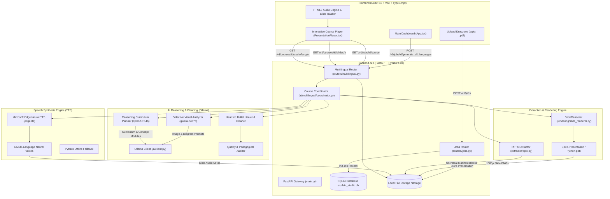

# Explain Studio — Master System Architecture, Implementation & Multi-System Deployment Manual

**Version:** 0.6.0 (Multilingual Educational Course Platform)  
**Author:** AI System Architecture & Engineering Team  
**Last Updated:** November 12, 2026  
**Document Classification:** Comprehensive Technical Reference & Deployment Runbook

---

## 1. Executive Overview & Core Innovations

**Explain Studio** is an AI-powered educational platform that transforms static presentation slide decks (PowerPoint `.pptx`, `.pdf`, `.docx`) into interactive, multilingual, professionally narrated digital courses.

### 1.1 The Problem Explain Studio Solves
Traditional presentation-to-video tools suffer from three fundamental flaws:
1. **Slow & Fragile Video Re-encoding:** Rendering a 10-slide video using FFmpeg or Manim takes 5 to 15 minutes, requires extensive GPU/CPU encoding, and produces a monolithic video file where slides cannot be interactively navigated or easily translated.
2. **Artificial & Degraded Visuals:** Re-generating slides with generative templates or HTML canvases strips away original fonts, diagrams, tables, and corporate branding.
3. **Mechanical Narration:** Bullet points are read verbatim with repetitive openers (e.g., *"Building on these principles...", "It is important to remember..."*) and broken fragments from split PowerPoint text frames.

### 1.2 Core Architectural Paradigm: Instant Synchronized Course Playback
Explain Studio solves these problems by decoupling **visual presentation** from **audio narration**:
- **Faithful 1080p Slide Preservation:** Each slide from the PowerPoint presentation is converted into a high-resolution 1080p (1920x1080) image preserving exact fonts, shapes, diagrams, colors, and layout. No artificial badges, avatars, or template overlays are added.
- **Single-Action Multilingual Generation:** In a single generation step, the backend analyzes the whole presentation, plans a structured curriculum, heals bullet fragments, authors engaging teaching explanations, translates them into 6 languages, and synthesizes neural audio.
- **Instant Playback (Zero Re-encoding Lag):** The frontend interactive player (`PresentationPlayer.tsx`) coordinates high-res slide images with HTML5 audio streams. The course is playable **immediately** after narration synthesis (in seconds rather than 10+ minutes).
- **Interactive Multi-Language Switching:** Learners can switch between English, Chinese, Malay, Tamil, Telugu, and Bangla on the fly while retaining their exact slide position and listening in crystal-clear neural audio.

---

## 2. System Architecture & Component Diagram

The following diagram illustrates the complete end-to-end dataflow from file upload to in-browser playback:



---

## 3. Current Project Structure

The project is cleanly decoupled into `backend`, `frontend`, `storage`, and verification `scripts`.

```
explain-studio-local-frontend-server-backend/
├── explain-studio/
│   ├── backend/
│   │   ├── app/
│   │   │   ├── ai/
│   │   │   │   ├── director/               # Educational Director & scriptwriter (legacy/test suites)
│   │   │   │   │   ├── duration.py         # Adaptive duration calculation
│   │   │   │   │   ├── grounding.py        # Visual element grounding
│   │   │   │   │   ├── pipeline.py         # Director stage pipeline
│   │   │   │   │   ├── planner.py          # Lesson structure planner
│   │   │   │   │   ├── qa.py               # Director artifact validation
│   │   │   │   │   ├── scriptwriter.py     # Narration script generation
│   │   │   │   │   └── storyboarder.py     # Scene storyboard generator
│   │   │   │   ├── multilingual/           # Active Multilingual Course Pipeline
│   │   │   │   │   ├── coordinator.py      # End-to-end course orchestrator & progress tracker
│   │   │   │   │   ├── glossary.py         # Technical terminology extraction & consistency
│   │   │   │   │   ├── models.py           # Course, Module, SlideExplanation & language models
│   │   │   │   │   ├── planner.py          # Bullet healing, deterministic fallback & prompt generation
│   │   │   │   │   ├── quality_auditor.py  # Quality validation (bad opener & duplicate sentence detection)
│   │   │   │   │   ├── reasoning_planner.py# Presentation-level holistic LLM understanding
│   │   │   │   │   ├── translator.py       # Multi-language translation engine
│   │   │   │   │   └── visual_analyzer.py  # Selective visual analysis via Qwen2.5-VL
│   │   │   │   ├── analyzer.py             # Document & content extraction analyzer
│   │   │   │   ├── client.py               # Ollama HTTP API client & connection pooling
│   │   │   │   ├── gpu.py                  # GPU VRAM and telemetry monitoring
│   │   │   │   └── models.py               # AI Pydantic data schemas
│   │   │   ├── extractor/                  # Universal Document Ingestion
│   │   │   │   ├── docx.py                 # Word document extraction
│   │   │   │   ├── image.py                # Standalone image ingestion
│   │   │   │   ├── models.py               # Extraction manifest & content block schemas
│   │   │   │   ├── pdf.py                  # PDF extraction
│   │   │   │   ├── pipeline.py             # Unified extraction runner
│   │   │   │   ├── pptx.py                 # python-pptx shapes, tables, notes extraction
│   │   │   │   └── text.py                 # Plaintext & markdown ingestion
│   │   │   ├── pipeline/
│   │   │   │   └── orchestrator.py         # Video pipeline orchestrator (for offline rendering)
│   │   │   ├── rendering/
│   │   │   │   ├── engines/                # Offline video rendering engines (Manim, MotionCanvas, Fallback)
│   │   │   │   ├── ffmpeg.py               # FFmpeg wrapper & media prober
│   │   │   │   ├── models.py               # Video rendering models
│   │   │   │   ├── multilingual_engine.py  # Audio generation runner across all languages
│   │   │   │   ├── registry.py             # Engine registry
│   │   │   │   └── slide_renderer.py       # Spire & PPTX 1080p original slide renderer
│   │   │   ├── routers/
│   │   │   │   ├── ai.py                   # /v1/ai/health, /v1/ai/models
│   │   │   │   ├── jobs.py                 # /v1/jobs CRUD, uploads, and source manifests
│   │   │   │   └── multilingual.py         # /v1/courses/*, audio/slide streaming, course package
│   │   │   ├── subtitles/
│   │   │   │   └── generator.py            # SRT subtitle generation
│   │   │   ├── tts/
│   │   │   │   ├── base.py                 # Abstract TTS provider
│   │   │   │   ├── edge_tts_provider.py    # Microsoft Edge neural TTS with sentence boundary sync
│   │   │   │   ├── factory.py              # TTS provider factory
│   │   │   │   ├── models.py               # TTS chunk results & word timestamps
│   │   │   │   ├── pyttsx3_provider.py     # Offline speech synthesis fallback
│   │   │   │   └── remote_provider.py      # HTTP-based external TTS
│   │   │   ├── config.py                   # Environment settings & directory paths
│   │   │   ├── db.py                       # SQLite persistence layer
│   │   │   ├── health.py                   # Health checks (/health/live, /health/ready)
│   │   │   ├── main.py                     # FastAPI application factory & lifespan
│   │   │   ├── models.py                   # Job status schemas
│   │   │   ├── storage.py                  # Storage path resolution utilities
│   │   │   ├── validation.py               # File validation & safety checks
│   │   │   └── worker.py                   # Background task runner
│   │   ├── scripts/                        # Utility & test verification scripts
│   │   │   ├── test_full_pipeline.py       # Full end-to-end integration test
│   │   │   └── test_narration_quality.py   # Narration quality & pedagogical checks
│   │   ├── storage/
│   │   │   ├── explain_studio.db           # SQLite database (jobs, files, status)
│   │   │   ├── courses/                    # Rendered 1080p slide PNGs, audio MP3s, course metadata
│   │   │   ├── extracted/                  # Universal content manifests & extracted assets
│   │   │   └── files/                      # Uploaded source presentation decks
│   │   ├── tests/                          # Automated Pytest suite (95 tests)
│   │   ├── .env                            # Active environment configuration
│   │   ├── .env.example                    # Environment variable template
│   │   └── requirements.txt                # Python backend dependencies
│   ├── frontend/
│   │   ├── src/
│   │   │   ├── api.ts                      # Typed API client & course schema definitions
│   │   │   ├── App.tsx                     # Main dashboard UI, drag-and-drop, progress tracker
│   │   │   ├── main.tsx                    # React DOM entrypoint
│   │   │   ├── PresentationPlayer.tsx      # Interactive slide-synchronized audio course player
│   │   │   ├── styles.css                  # Dark-themed responsive stylesheet
│   │   │   └── vite-env.d.ts               # Vite TypeScript definitions
│   │   ├── index.html                      # HTML5 single page app template
│   │   ├── package.json                    # Frontend dependencies & npm scripts
│   │   ├── tsconfig.json                   # TypeScript configuration
│   │   ├── vite.config.ts                  # Vite build & proxy configuration
│   │   ├── .env.example                    # Frontend environment template
│   │   └── .env.local                      # Active frontend environment (API base URL)
│   └── test_decks/                         # Presentation decks for testing and benchmarking
└── scripts/                                # Master acceptance & benchmarking tools
```

---

## 4. End-to-End Pipeline: From Upload to Playable Course

The course generation pipeline operates in 6 sequential stages coordinated by `MultilingualCourseCoordinator`:

### Stage 1: PowerPoint Ingestion & 1080p Slide Rendering
- **File Ingestion:** The user drops a `.pptx` file into `App.tsx`, which sends a multipart upload to `POST /v1/jobs`.
- **High-Fidelity Rendering:** `SlideRenderer` renders each slide into a 1080p (1920x1080) PNG image.
  - Primary engine: `spire.presentation` (`slide.SaveAsImage()`), capturing native fonts, tables, shapes, and images.
  - Rescaling: Slides with 16:9 aspect ratio are smoothly scaled using Lanczos interpolation; non-16:9 slides are proportionally centered with subtle sampled edge letterboxing.
- **Content Extraction:** `extractor/pptx.py` extracts raw text, titles, bullet lists, tables, presenter notes, and embedded image assets into a structured `manifest.json`.

### Stage 2: Presentation-Level Understanding & Selective Vision
- **Holistic Reasoning:** `ReasoningPlanner` inspects the entire presentation context using `qwen2.5:14b`. It identifies:
  - Subject and domain context (e.g., Industrial Workplace Safety, Driver Training).
  - Target audience and prerequisite knowledge.
  - Overall learning objectives.
  - Core concepts and concept dependencies.
  - Technical terms for glossary consistency.
- **Selective Visual Analysis:** Rather than inspecting all slides, `should_inspect_slide_visually` only analyzes slides containing complex diagrams, charts, or images with `qwen2.5vl:7b`, reducing LLM processing time.

### Stage 3: Modular Curriculum Planning
- **Concept Grouping:** Slides are grouped into 2 to 5 coherent thematic modules (e.g., Module 1: *Introduction & Responsibilities*, Module 2: *Emergency Procedures*).
- **Strict Invariant:** Every original slide must belong to **exactly one module**. The coordinator validates:
  $$\text{total\_allocated\_slides} = \text{total\_presentation\_slides}, \quad \text{missing\_slides} = \emptyset, \quad \text{overlaps} = \emptyset$$
  If any slide is dropped by the model, `_repair_slide_allocation` automatically restores and assigns it.

### Stage 4: Slide-by-Slide Pedagogical Explanation & Bullet Healing
- **Dangling Bullet Healing:** Raw PowerPoint bullets frequently split across lines (e.g., Bullet 1: *"Please ensure that you are escorted by our"*, Bullet 2: *"employees throughout your visit"*). `heal_and_clean_bullets` recombines dangling fragments ending with prepositions (`by`, `our`, `the`, `in`, `to`, `for`).
- **Conversational Teaching Tone:** The model generates natural spoken narration explaining the slide as an expert teacher.
  - **No Bad Openers:** Banned phrases like *"Building on these principles..."*, *"It is important to remember..."*, and *"This slide shows..."* are forbidden.
  - **No Duplicate Sentences:** Sentences within an explanation are de-duplicated.
- **Pedagogical Auditor:** `quality_auditor.py` programmatically checks every generated explanation and automatically heals any stylistic defects.

### Stage 5: Multilingual Adaptation & Glossary Preservation
- Narration is adapted into 6 target languages: **English (`en`)**, **Chinese Simplified (`zh-CN`)**, **Malay (`ms`)**, **Tamil (`ta`)**, **Telugu (`te`)**, and **Bangla (`bn`)**.
- A domain glossary guarantees that technical acronyms (PPE, OSHA, 5S, Emergency Contacts) remain accurate and consistent across all language tracks.

### Stage 6: Neural Speech Synthesis (TTS)
- `EdgeTTSProvider` generates natural speech for each slide using high-fidelity Microsoft Edge neural voices:
  - English: `en-US-ChristopherNeural` (Rate: -3% relaxed educational cadence)
  - Chinese: `zh-CN-XiaoxiaoNeural`
  - Malay: `ms-MY-OsmanNeural`
  - Tamil: `ta-IN-ValluvarNeural`
  - Telugu: `te-IN-MohanNeural`
  - Bangla: `bn-IN-BashkarNeural`
- Captures sentence boundary timestamps, verifies audio file durations, and builds the full `course_metadata.json` manifest.

### Stage 7: Interactive HTML5 Playback
- The client receives the `MultilingualCourse` package.
- `PresentationPlayer.tsx` renders the 1080p slide PNG, binds the slide's audio stream, and handles real-time time tracking, scrub bars, slide drawers, speed adjustments (0.75x to 2x), and instant language switching.

---

## 5. Technical Stack & Requirements

### Backend Requirements
| Component | Technology | Version | Purpose |
| :--- | :--- | :--- | :--- |
| **Runtime** | Python | 3.10+ | Core language environment |
| **API Framework** | FastAPI | 0.115+ | High-performance asynchronous REST API |
| **ASGI Server** | Uvicorn | 0.30+ | Production ASGI server |
| **Database** | SQLite3 | 3.35+ | Job status, file metadata, and course persistence |
| **Presentation Engine**| `spire.presentation` | 11.8+ | Native high-fidelity PPTX slide rendering |
| **Fallback PPTX** | `python-pptx` | 1.0.2+ | Slide text, table, and image extraction |
| **Image Processing** | Pillow (PIL) | 10.0+ | Image resizing, letterboxing, 1080p canvas |
| **TTS Provider** | `edge-tts` | 7.3+ | Free, high-fidelity neural cloud speech synthesis |
| **Offline TTS** | `pyttsx3` | 2.99+ | Offline text-to-speech fallback |
| **Media Prober** | FFmpeg / `imageio-ffmpeg` | 5.0+ | Audio duration and media probing |
| **HTTP Client** | `httpx` | 0.27+ | Asynchronous communication with Ollama |

### Frontend Requirements
| Component | Technology | Version | Purpose |
| :--- | :--- | :--- | :--- |
| **Runtime** | Node.js | 18+ (or 20 LTS) | JavaScript runtime & tooling |
| **UI Library** | React | 18.3.1 | Component rendering & reactive state |
| **Language** | TypeScript | 5.7+ | Strict type safety and interface contracts |
| **Bundler / Dev** | Vite | 6.0+ | Fast HMR dev server and production builder |
| **Icons** | `lucide-react` | 0.468+ | Clean modern UI icons |
| **Styling** | Vanilla CSS3 | Standard | Custom dark-mode glassmorphic theme |

### AI Inference Engine Requirements (Ollama)
| Model | Role | Quantization | Recommended VRAM |
| :--- | :--- | :--- | :--- |
| `qwen2.5:14b` | Curriculum planning, reasoning, pedagogical scriptwriting, translation | Q4_K_M | 10–12 GB VRAM |
| `qwen2.5vl:7b` | Selective vision, diagram reading, OCR | Q4_K_M | 6–8 GB VRAM |
| *(Alternative / CPU)* | `qwen2.5:7b` | Unified text & lightweight reasoning | 5–6 GB RAM |

---

## 6. How to Run on Another System (Step-by-Step)

Follow these instructions to clone, configure, and run Explain Studio on any Windows, macOS, or Linux development machine.

### Step 6.1: Prerequisites Installation

1. **Install Python 3.10 or 3.11:**
   - Windows: Download from [python.org](https://www.python.org/) (check *"Add Python to PATH"* during install).
   - Ubuntu/Debian: `sudo apt update && sudo apt install python3.10 python3.10-venv python3-pip -y`
   - macOS: `brew install python@3.10`

2. **Install Node.js 18+ & npm:**
   - Windows/macOS: Download Node.js LTS from [nodejs.org](https://nodejs.org/).
   - Linux: `curl -fsSL https://deb.nodesource.com/setup_20.x | sudo -E bash - && sudo apt install nodejs -y`

3. **Install FFmpeg (Recommended for audio probing):**
   - Windows: `winget install Gyan.FFmpeg`
   - Linux: `sudo apt install ffmpeg -y`
   - macOS: `brew install ffmpeg`

---

### Step 6.2: Set Up Ollama (AI Models)

Explain Studio requires an Ollama instance running the models `qwen2.5:14b` and `qwen2.5vl:7b`.

#### Option A: Running Ollama Locally (If you have an NVIDIA GPU with 12GB+ VRAM)
1. Download Ollama from [ollama.ai](https://ollama.ai/).
2. Pull the required models:
   ```bash
   ollama pull qwen2.5:14b
   ollama pull qwen2.5vl:7b
   ```
3. Ollama runs on `http://127.0.0.1:11434` by default.

#### Option B: Connecting to a Remote GPU Server via SSH Tunnel
If your local machine does not have a dedicated GPU, run Ollama on a remote GPU server and tunnel it:
```bash
# Forward local port 11435 to remote Ollama port 11434
ssh -N -L 11435:127.0.0.1:11434 user@your-gpu-server-ip
```

---

### Step 6.3: Backend Setup

1. Open a terminal and navigate to the backend directory:
   ```bash
   cd explain-studio-local-frontend-server-backend/explain-studio/backend
   ```

2. Create and activate a Python virtual environment:
   - **Windows:**
     ```powershell
     python -m venv .venv
     .venv\Scripts\activate
     ```
   - **Linux / macOS:**
     ```bash
     python3 -m venv .venv
     source .venv/bin/activate
     ```

3. Install backend dependencies:
   ```bash
   pip install --upgrade pip
   pip install -r requirements.txt
   pip install spire.presentation edge-tts pyttsx3 pydantic fastapi uvicorn
   ```

4. Configure the environment file:
   - Create a file named `.env` in `explain-studio/backend/`:
     ```ini
     # If running Ollama locally:
     # EXPLAIN_STUDIO_OLLAMA_BASE_URL=http://127.0.0.1:11434

     # If running via SSH tunnel on port 11435:
     EXPLAIN_STUDIO_OLLAMA_BASE_URL=http://127.0.0.1:11435

     EXPLAIN_STUDIO_OLLAMA_TEXT_MODEL=qwen2.5:14b
     EXPLAIN_STUDIO_OLLAMA_VISION_MODEL=qwen2.5vl:7b
     EXPLAIN_STUDIO_TTS_PROVIDER=auto
     EXPLAIN_STUDIO_TTS_VOICE=en-US-ChristopherNeural
     EXPLAIN_STUDIO_ALLOWED_ORIGINS=http://localhost:5173,http://127.0.0.1:5173
     ```

5. Start the backend development server:
   ```bash
   uvicorn app.main:app --host 127.0.0.1 --port 8000 --reload
   ```

6. Verify backend is running:
   Open a browser or terminal and navigate to `http://127.0.0.1:8000/health`. You should see:
   ```json
   {"status":"ok","service":"explain-studio-backend","version":"0.6.0","ai_enabled":true}
   ```

---

### Step 6.4: Frontend Setup

1. Open a second terminal window and navigate to the frontend directory:
   ```bash
   cd explain-studio-local-frontend-server-backend/explain-studio/frontend
   ```

2. Install Node dependencies:
   ```bash
   npm install
   ```

3. Configure `.env.local`:
   Ensure `explain-studio/frontend/.env.local` contains:
   ```ini
   VITE_API_BASE_URL=http://127.0.0.1:8000
   ```

4. Start the Vite development server:
   ```bash
   npm run dev
   ```
   The dev server will output:
   ```
     VITE v6.0.7  ready in 450 ms

     ➜  Local:   http://127.0.0.1:5173/
   ```

5. Open `http://127.0.0.1:5173` in your web browser.

---

### Step 6.5: End-to-End Verification Run

1. On the web dashboard at `http://127.0.0.1:5173`, observe the system status indicator:
   - **Backend API:** Green checkmark (Online)
   - **Ollama AI:** Green checkmark (`qwen2.5:14b` & `qwen2.5vl:7b` detected)
2. Drag and drop any presentation from `explain-studio/test_decks/` (e.g., `4_safety_briefing.pptx`).
3. Click **"Generate Multilingual Course"**.
4. The system will display live progress:
   - *Rendering original 1080p slides*
   - *Selective visual inspection*
   - *Curriculum planning & pedagogical scriptwriting*
   - *Synthesizing audio across 6 languages*
5. Once complete, the **Interactive Presentation Player** launches automatically. Test:
   - Audio playback (play/pause, timeline scrubber).
   - Language selector dropdown (switch to Telugu, Chinese, Tamil, etc.).
   - Fullscreen mode and slide drawer navigation.

---

## 7. How to Implement & Deploy in Production

For a dedicated server or cloud instance (Ubuntu 22.04 / 24.04 LTS), deploy using standard production architecture:

### 7.1 Production Architecture Diagram

```mermaid
flowchart LR
    User([End User Browser]) -->|HTTPS :443| Nginx[Nginx Reverse Proxy & Static Host]
    Nginx -->|/ (Static Assets)| DistDir[/frontend/dist]
    Nginx -->|/v1/*, /health| Backend[Uvicorn / Gunicorn Workers :8000]
    Backend --> Storage[(Persistent Disk /storage)]
    Backend -->|Internal :11434| Ollama[Ollama GPU Server]
```

---

### 7.2 Building the Frontend for Production

Compile the TypeScript and React code into an optimized static distribution:
```bash
cd explain-studio/frontend
npm run build
```
This generates static HTML, CSS, and JS files in `explain-studio/frontend/dist/`.

---

### 7.3 Nginx Reverse Proxy Configuration

Create `/etc/nginx/sites-available/explain-studio.conf`:

```nginx
server {
    listen 80;
    server_name explain.yourdomain.com;
    client_max_body_size 100M;

    # Frontend Static Distribution
    location / {
        root /var/www/explain-studio/frontend/dist;
        index index.html;
        try_files $uri $uri/ /index.html;
    }

    # Backend API Endpoints
    location ~ ^/(v1|health|openapi.json|docs|redoc) {
        proxy_pass http://127.0.0.1:8000;
        proxy_http_version 1.1;
        proxy_set_header Upgrade $http_upgrade;
        proxy_set_header Connection 'upgrade';
        proxy_set_header Host $host;
        proxy_set_header X-Real-IP $remote_addr;
        proxy_set_header X-Forwarded-For $proxy_add_x_forwarded_for;
        proxy_set_header X-Forwarded-Proto $scheme;
        proxy_read_timeout 600s;
        proxy_connect_timeout 60s;
    }
}
```

Enable the configuration and reload Nginx:
```bash
sudo ln -s /etc/nginx/sites-available/explain-studio.conf /etc/nginx/sites-enabled/
sudo nginx -t && sudo systemctl reload nginx
```

---

### 7.4 Running the Backend as a Systemd Service

Create `/etc/systemd/system/explain-studio-backend.service`:

```ini
[Unit]
Description=Explain Studio FastAPI Backend Service
After=network.target

[Service]
Type=simple
User=ubuntu
WorkingDirectory=/var/www/explain-studio/backend
Environment="PATH=/var/www/explain-studio/backend/.venv/bin"
EnvironmentFile=/var/www/explain-studio/backend/.env
ExecStart=/var/www/explain-studio/backend/.venv/bin/uvicorn app.main:app --host 127.0.0.1 --port 8000 --workers 2

Restart=always
RestartSec=5

[Install]
WantedBy=multi-user.target
```

Enable and start the service:
```bash
sudo systemctl daemon-reload
sudo systemctl enable explain-studio-backend
sudo systemctl start explain-studio-backend
sudo systemctl status explain-studio-backend
```

---

### 7.5 Docker Containerization (Optional)

To package the entire application in Docker containers, use the following `docker-compose.yml`:

```yaml
version: '3.8'

services:
  backend:
    build:
      context: ./explain-studio/backend
      dockerfile: Dockerfile
    container_name: explain_studio_backend
    restart: always
    ports:
      - "8000:8000"
    environment:
      - EXPLAIN_STUDIO_OLLAMA_BASE_URL=http://host.docker.internal:11434
      - EXPLAIN_STUDIO_TTS_PROVIDER=auto
      - EXPLAIN_STUDIO_STORAGE_DIR=/app/storage
    volumes:
      - explain_storage:/app/storage
    extra_hosts:
      - "host.docker.internal:host-gateway"

  frontend:
    build:
      context: ./explain-studio/frontend
      dockerfile: Dockerfile
    container_name: explain_studio_frontend
    restart: always
    ports:
      - "5173:80"
    depends_on:
      - backend

volumes:
  explain_storage:
```

---

## 8. Troubleshooting & Operational Runbook

### Issue 1: "Cannot connect to Ollama" or "AI Service Unavailable"
- **Symptom:** The frontend displays an alert that Ollama is unreachable; `GET /v1/ai/health` returns status `unreachable`.
- **Root Cause:** Ollama daemon is not running, or the SSH tunnel has dropped.
- **Resolution:**
  1. If running locally: execute `ollama serve`.
  2. If using an SSH tunnel: check if the tunnel command is active:
     ```bash
     ssh -N -L 11435:127.0.0.1:11434 user@server
     ```
  3. Verify port connectivity with `curl http://127.0.0.1:11435/api/tags`.

### Issue 2: Spire Presentation Font Rendering on Linux
- **Symptom:** Slide texts render with fallback fonts or misaligned margins when running on headless Linux.
- **Root Cause:** Standard Linux distributions do not include Microsoft TrueType core fonts (Arial, Calibri).
- **Resolution:** Install the font package on Ubuntu:
  ```bash
  sudo apt install ttf-mscorefonts-installer fontconfig -y
  sudo fc-cache -f -v
  ```

### Issue 3: Edge TTS Network Latency or 403 Forbidden
- **Symptom:** Audio synthesis times out or throws an error during generation.
- **Root Cause:** Microsoft Edge TTS cloud endpoint temporarily throttled or DNS blocked.
- **Resolution:** Explain Studio features an automated retry policy (3 exponential attempts) followed by an automatic fallback to `pyttsx3_provider`. If operating in a strictly offline environment, set in `.env`:
  ```ini
  EXPLAIN_STUDIO_TTS_PROVIDER=offline
  ```

### Issue 4: Database Concurrency / SQLite Busy
- **Symptom:** `sqlite3.OperationalError: database is locked`.
- **Root Cause:** High concurrent writes on `explain_studio.db`.
- **Resolution:** `app/db.py` enforces SQLite WAL (Write-Ahead Logging) mode and connection timeouts. Ensure `PRAGMA journal_mode=WAL;` is enabled and storage directory has read/write permissions.

---

## 9. Verification & Acceptance Commands

To verify that any new system installation is completely working, execute the automated acceptance suites:

```bash
# 1. Run full backend unit and regression test suite (95 tests)
cd explain-studio/backend
.venv\Scripts\python.exe -m pytest tests -q --tb=short

# 2. Run frontend production build test
cd ../frontend
npm run build

# 3. Run automated narration quality check
cd ../backend
.venv\Scripts\python.exe scripts/test_narration_quality.py

# 4. Run end-to-end multi-subject acceptance suite
cd ../..
python scripts/run_strict_performance_acceptance.py
```
Expected output: **100% PASS** on all suites.
